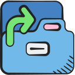

# Tab Backup



A Firefox extension for exporting the tabs in the current window to a JSON
file and restoring tabs from a previous export.

[Install Tab Backup from Firefox Add-ons](https://addons.mozilla.org/en-GB/firefox/addon/tab-backup/)

## Requirements

- A current Node.js LTS release
- [pnpm](https://pnpm.io/installation)
- Firefox or Firefox Developer Edition

## Install dependencies

```sh
pnpm install
```

## Test in Firefox

Firefox must load the compiled extension from `dist`. The files in `src`
import CSS that webpack compiles with Tailwind, so they cannot be loaded
directly.

### Manual testing

This workflow works with any local Firefox installation:

1. Build the extension:

   ```sh
   pnpm build
   ```

2. Open `about:debugging` in Firefox.
3. Select **This Firefox**.
4. Select **Load Temporary Add-on**.
5. Choose `dist/manifest.json` from this repository.

The temporary extension remains installed until it is removed or Firefox is
restarted. After changing the source, run `pnpm build` again and select
**Reload** next to Tab Backup on the `about:debugging` page.

### Watch mode

To rebuild `dist` whenever a source file changes, run:

```sh
pnpm start
```

Load `dist/manifest.json` using the [manual testing](#manual-testing) workflow.
After a rebuild, select **Reload** next to Tab Backup on `about:debugging`.
Press `Ctrl+C` to stop watching.

### Firefox Developer Edition

To rebuild on changes and also launch Firefox Developer Edition with the
extension installed and reloaded automatically, run:

```sh
pnpm dev
```

The temporary profile does not contain your usual tabs, accounts, settings, or
installed add-ons, and its changes are discarded when the process stops. The
Firefox executable is configured in `webpack.config.mjs`.

To run `web-ext` directly against an existing build (it reads the `webExt`
settings in `package.json`, which point at `dist` and Developer Edition):

```sh
pnpm exec web-ext run --devtools
```

To test Tab Backup with your existing Firefox profile and real tabs, keep your
normal Firefox window open and use the [manual testing](#manual-testing)
workflow instead. Loading `dist/manifest.json` from `about:debugging` installs
the extension temporarily in that running profile without configuring webpack
to write to your everyday profile.

If `pnpm dev` reports that a profile is already in use, close the
Firefox window previously opened by the command and run it again. A dedicated
reusable development profile can also be selected with the `firefoxProfile`
option in `webpack.config.mjs`, but it should not point to a profile used for
everyday browsing.

### Suggested smoke test

1. Confirm the toolbar badge shows the number of open tabs.
2. Open the extension popup and confirm the current window's tabs are listed.
3. Select a tab title and confirm Firefox activates that tab.
4. Select **Back up** and confirm a timestamped JSON file is saved.
5. Select **Restore…**, choose the exported file, and confirm its tabs reopen.
6. Open settings with the sliders button, pick another format and file name
   pattern, and confirm the next backup uses them and still restores.
7. Open and close a tab and confirm the badge count changes.

To inspect runtime errors, find Tab Backup on `about:debugging` and select
**Inspect**.

To check the built extension with Mozilla's add-on linter, run:

```sh
pnpm lint
```

For more detail, see Mozilla's guides to
[temporary installation](https://extensionworkshop.com/documentation/develop/temporary-installation-in-firefox/)
and [`web-ext`](https://extensionworkshop.com/documentation/develop/getting-started-with-web-ext/).

## Build a package

```sh
pnpm build
pnpm build-extension
```

The packaged extension is written to `web-ext-artifacts`. Regular Firefox
builds require extensions to be signed for permanent installation; use the
temporary installation workflow above for local development.

The `web-ext` configuration is in `package.json` and the webpack integration is
in `webpack.config.mjs`.

## Assets

The interface icons come from [Tabler Icons](https://github.com/tabler/tabler-icons).
The folder icon is by
[Smashicons on Freepik](https://www.freepik.com/icon/folder_10773696).
